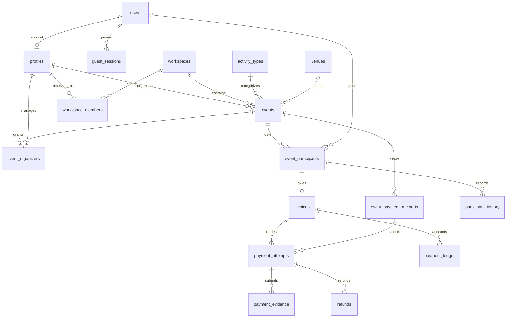

# Dolend database foundation (T04)

Schema source: `supabase/migrations/`. Data dictionary: [DATA-DICTIONARY.md](DATA-DICTIONARY.md). Generated SDK contracts: `src/lib/database.types.ts`. `public.users` is the stable business identity for guests and members; `auth.users` remains Supabase's login identity. `profiles.user_id` binds the two UUIDs after verification.

## Data model



Twenty-five business tables use UUID keys; `profiles.id` reuses the Supabase Auth UUID. Google OAuth is the login identity for organizers. A canonical Indonesian WhatsApp (`62...`, stored as nullable text) identifies guest contact when present; PostgreSQL enforces shape/uniqueness and the API performs full metadata validation. It is not a login credential or a primary key.

Identity tables: users, profiles, verification_challenges (legacy/future claim proof), identity_claims, guest_sessions. Permission tables: workspaces, workspace_members, event_organizers. Event tables: activity_types, venues, events, event_invites, event_participants, participant_history, event_payment_methods. Billing tables: invoices, payment_attempts, payment_evidence, payment_ledger, refunds, webhook_events. Operations: idempotency_records, audit_logs, outbox_jobs, rate_limit_counters.

All mutable tables have updated_at triggers. Money is integer IDR, bounded to 1e12 rupiah per row; timestamps are timestamptz, event timezone is an IANA name validated against PostgreSQL. Profiles/financial relations use restrict foreign keys, preventing accidental history loss through cascading account deletion. Audit/outbox entity IDs are intentionally polymorphic and not foreign keys.

## Read/write boundary

| Resource | Anonymous | Member browser | Trusted API/service |
| --- | --- | --- | --- |
| activity_types | Active rows | Active rows | Manage reference data |
| public_events view | Public published/completed safe fields | Same projection | Same projection |
| users / profiles | Denied | Own identity/profile only | Resolve verified identity and scoped roster DTO |
| profile bio/avatar/timezone | Denied | Update own permitted columns | Identity binding through trusted flow |
| events / venues | Denied raw table | Own venue; organizer/participant-related event | Ownership-checked domain operations |
| participants/history | Denied | Own participation or organized event | Transactional roster RPC |
| methods/invoices/attempts/evidence/refunds | Denied | Own participation or organized event | Scoped payment operations |
| guest sessions, invites, challenges, claims | Denied | Denied raw table | Verify hashed proof and scope |
| ledger/audit/outbox/webhooks/idempotency/rate limits | Denied | Denied | Server operations; ledger/audit/history SELECT+INSERT only at runtime |

All 25 tables have RLS. Every foreign key has a leading-column index. Transactional domain RPCs remain service-only, except `bootstrap_google_profile()` which is granted only to `authenticated` and derives its owner from `auth.uid()`. RLS helpers live in non-exposed `dolend_private`, use fixed empty search_path and explicit relation qualification. Do not add that schema to the Data API schema list.

`public_events` is intentionally a **definer-owned security-barrier view** with explicit column allowlist and visibility/status filter; it is not a generic select-* view. This can be flagged by automated advisors as a definer view and must be reviewed in that context. It never exposes phone, guest/invite tokens, bank instructions, arbitrary venue JSON, evidence, or ledger rows. Raw users read remains own-only even for organizers; future roster API must return only the fields justified for the organizer.

Guest session rows are not readable from a browser. Elysia creates a 256-bit bearer token, stores only its SHA-256 through a service-only RPC, and never accepts arbitrary actor/profile/user IDs from client input. Service-role bypasses RLS; never expose its key and never treat RLS as a substitute for API authorization. Mutating schemas, roles, triggers, or ledger through privileged database maintenance is outside the runtime boundary.

## Domain transactions

| RPC | Main invariants |
| --- | --- |
| join_event | Google member or event-scoped token guest; event deadline/lifecycle; lock event; capacity; unique user/event; one invoice; replay returns same active participant |
| create_guest_booking | Service-only; validates open event/name/canonical WhatsApp/token hash; locks event+user; rejects duplicate before issuing a new session; creates scoped session and participant atomically |
| get_guest_booking | Service-only; menerima event+token hash dan mengembalikan hanya status/timestamp partisipasi scoped yang masih aktif |
| consume_guest_booking_limits | Service-only; atomik fixed-window counter per event/contact HMAC dan event/IP HMAC; tidak menyimpan identifier mentah; mengembalikan allowed serta Retry-After |
| rotate_guest_booking_token | Service-only; organizer event saja; mengunci guest participant aktif, mencabut sesi lama, membuat token hash baru, dan mencatat audit tanpa memakai nomor sebagai proof |
| bootstrap_google_profile | Authenticated only; validates Google provider/email from `auth.users`; idempotently creates business user, profile, personal workspace and owner membership |
| create_payment_attempt | Owner proof, event-enabled method, invoice amount/currency, invoice/key idempotency; overdue postpay can still create a future-expiring attempt |
| submit_manual_evidence | Owner proof; manual-only; bounded review deadline; metadata constraints; temporary hold extension bounded by event start |
| approve_manual_payment | Verified organizer; evidence required; reason mandatory; invoice/receipt/participant updated atomically; late receipt can become an exception |
| apply_provider_payment | Service-only; provider/reference/amount/currency match; stable receipt source; duplicate callbacks idempotent |
| expire_holds | Event lock, bounded event scope, state-based replay; expired holds no longer occupy seats |
| cancel_participation / cancel_event | Ownership proof, release seats, unpaid invoice void, paid receipt retains ledger and queues refund review |
| request_refund / record_refund | Organizer proof; bounded refundable amount; request idempotency; receipt-backed refund; manual refund evidence required; duplicate completion is safe |
| claim_guest_identity | Account+challenge binding, verified unexpired single-use proof, Auth phone matches business user, collision rejection, historical joined_as retained |

The common lock order is event → participant → invoice → attempt/refund; some paths can omit unneeded locks. Capacity edits acquire the event row lock as part of UPDATE. Server code should use the supplied RPCs; direct participant updates may encounter deadlocks with conflicting operations and should not be used to implement business transitions. Any future mutation RPC (for example attendance) must preserve the lock convention.

Triggers protect immutable ownership/identity, valid transitions, capacity floor, before-event confirmation without payment, amount/currency/method consistency, invoice price snapshots, monotonic succeeded state, immutable provider reference, receipt-backed success, duplicate receipt prevention and refund <= recorded receipts. Ledger rows use positive amounts with entry_type indicating receipt/refund/adjustment. Paid invoices remain paid after refund; refunds are separate records, not an invoice downgrade.

A late prepay receipt is always retained. When no seat remains or event is closed/cancelled, an exception is queued rather than overbooking or pretending a refund completed. Duplicate success after an invoice was already paid does not silently drop money; a distinct attempt is recorded with an invoice-state exception.

## Migration and verification commands

```sh
npm run db:test
npm run supabase -- db push --linked --project-ref fpbefabsqryxmnmxufjw --dry-run
npm run supabase -- db push --linked --project-ref fpbefabsqryxmnmxufjw --yes
DATABASE_TEST_PROJECT_REF=fpbefabsqryxmnmxufjw npm run db:test:hosted
```

Migrations are append-only once applied. Reference activity categories are seeded by a versioned migration; separate db.seed is disabled to avoid a missing/duplicate seed file. Never reset the hosted database to run tests. A local Supabase reset on an isolated Docker project may replay all migrations when Docker is available.

Local verification uses PGlite with minimal Auth table/function stubs, then replays migrations from empty schema. It tests database logic, not Supabase Auth's internal implementation or real concurrency. A PGlite datadir export/import verifies local snapshot recovery and data/RLS preservation; this format is not a production PostgreSQL backup.

Hosted verification uses disposable Auth accounts, synthetic users and scoped events. It exercises actual RPC/RLS/parallel Postgres transactions, real hold expiry, and duplicate payment/refund callbacks without contacting any payment provider. Credentials are held in memory; cleanup state IDs are stored in gitignored `.env.database-state.json`. Temporary SQL cleanup runs as a privileged database operator, deletes only tracked fixtures in FK order, then removes fixture users. If cleanup fails, keep that state and run:

```sh
DATABASE_TEST_PROJECT_REF=fpbefabsqryxmnmxufjw npm run db:test:hosted -- cleanup
```

No live email/SMS or money is sent. Generated dictionary/catalog checks contain schema metadata only. Detailed evidence is in [DATABASE-RESULTS.md](DATABASE-RESULTS.md).

## Backup, rollback and production release

1. Before changes on a populated environment, take a Supabase-managed backup/PITR checkpoint if the project's tier provides it, or a pg_dump backup using a controlled admin connection. Include Auth relations needed by profiles and Storage metadata; back up actual private objects separately. Do not commit dumps, connection strings, or bucket files.
2. Restore into an isolated matching PostgreSQL/Supabase environment first; check migration history, row counts, foreign keys, RLS/grants, receipt/refund totals, and object access. Map or restore Auth identities consistently; public schema alone cannot recreate user identities.
3. For a bad migration, prefer an additive repair migration and compatible API rollback. Do not delete/rewrite applied files or use db reset on the hosted environment. Financial correction uses compensating ledger entries, not rewriting receipt history.
4. The complete managed-backup/production restore drill remains a release gate at T20/T21. T04 proves fresh replay plus local snapshot restore, not that paid-tier PITR or cross-project production recovery is already enabled.

Private bucket creation/policies, actual file validation and signed URL access are T13. Google provider configuration, hosted callback verification, guest-token recovery, and recycled-number handling remain T08/T20. Provider signature verification/reconciliation stays T16/T19; the service-only receipt RPC itself cannot verify a gateway signature. Default cancellation policies/refund entitlement need product decisions; T04 queues review and bounds financial totals rather than inventing automatic refunds.

References: [Supabase migrations](https://supabase.com/docs/guides/deployment/database-migrations), [database functions](https://supabase.com/docs/guides/database/functions), [PostgreSQL locks](https://www.postgresql.org/docs/17/explicit-locking.html), [RLS](https://www.postgresql.org/docs/17/ddl-rowsecurity.html).

## Revisi iuran manual — 31 Oktober 2026

Migration `20261031090000_dynamic_manual_contributions.sql` menambahkan mode dynamic pada events; invoice/attempt/ledger lama tidak diubah. Dynamic memakai payment_mode free sebagai kompatibilitas roster lama, sedangkan kewajiban uang berasal dari participant_charges dan payment_timing, bukan price_amount. Jangan menafsirkan price_amount=0 sebagai gratis untuk event dynamic.

Tagihan baru terhubung ke event_participants yang sama. participant_charges menyimpan snapshot immutable, manual_payment_records mencatat laporan parsial, contribution_ledger mencatat receipt/refund/adjustment append-only. Balance = amount + adjustment + refund − receipt; nilai negatif berarti kelebihan bayar. Review RPC mengunci event lalu record, memverifikasi organizer dan mencatat satu receipt untuk satu laporan. Cash memakai report + review oleh organizer. Pembatalan setelah lock memilih retain/waive; waive menambah adjustment dan tidak menghapus receipt/refund.

Bucket dolend-payments bersifat private, batas PNG/JPG 2 MB. Browser tidak mendapat izin tabel atau Storage langsung. API memeriksa owner/guest scope sebelum upload dan signed URL 120 detik. File QRIS pengganti menjadi metode baru; metode lama dinonaktifkan agar riwayat tetap utuh. Gambar bukan bukti QRIS valid atau uang sudah masuk; organizer memeriksa penerimaan sendiri.

Verifikasi transaksi hosted yang rollback fixture: `DATABASE_TEST_PROJECT_REF=fpbefabsqryxmnmxufjw node scripts/database/manual-hosted-test.mjs`. Ini tidak membuktikan race lintas koneksi atau seluruh E2E Storage. Backup schema dan data pra-migration disimpan di luar repository; bukan bukti drill restore produksi.
